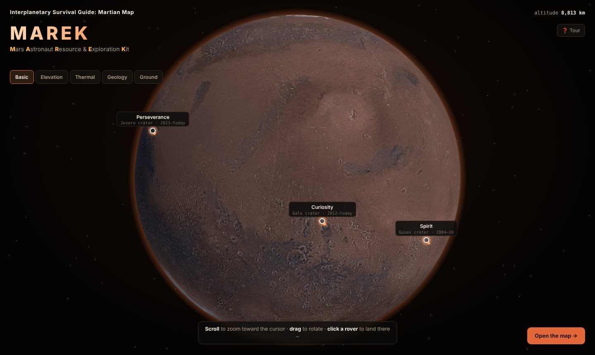
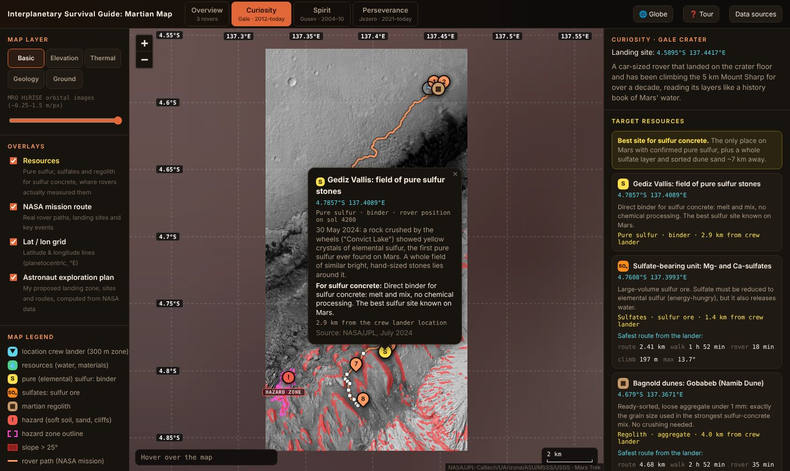
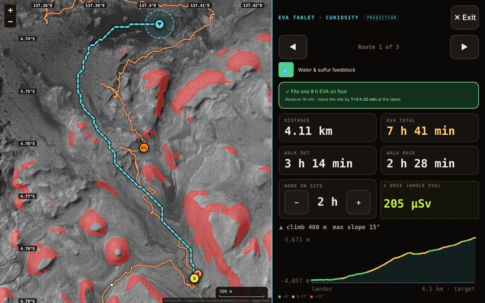

# Interplanetary Survival Guide: Martian Map

**NASA Space Apps Challenge 2026 · "Interplanetary Survival Guide: Martian Map"**

An interactive Mars globe and map built from real NASA data. It follows three rovers (**Curiosity**, **Spirit** and **Perseverance**) on their real paths. Its focus is the mission goal of finding **pure sulfur, sulfates and regolith for sulfur concrete**, together with landing zones and routes proposed for a first crew.



> **Live demo:** https://astrolan69.github.io/Interplanetary-Survival-Guide-Martian-Map/
> (GitHub Pages; open `index.html` from a local web server if Pages is not enabled yet.)

---

## What it does

| | |
|---|---|
| **Guided tour** | A 15-step walkthrough starts on the first visit: mission paths, layers, legend symbols, overlays, the readout, the mission panel, picking a single route (radiation and EVA budget) and the EVA tablet. It can be replayed with **❓ Tour**. |
| **3D globe start** | The app opens on a rotating Mars globe (three.js). Scroll zooms toward the cursor, dragging rotates it, and clicking a rover lands on its site. Below ~300 km altitude it switches to the 2D map. |
| **5 data layers** | *Basic* (Viking MDIM 2.1, HiRISE), *Elevation* (MOLA, HRSC, HiRISE DEMs, colored by true height with contour lines and hover readout), *Thermal* (Mars Odyssey THEMIS day/night IR plus measured rover temperatures), *Geology* (USGS SIM 3292 global geologic map, 44 units, plus orbital water-mineral detections) and *Ground* (walking conditions interpreted from MGS TES thermal inertia). |
| **Real rover paths** | Official traverses: NASA/JPL MMGIS for Curiosity (to sol 5073) and Perseverance (to sol 2022) plus Ingenuity's 72 flights, and the PDS MER Analyst's Notebook for Spirit (sols 1–2209). The paths were checked against official odometry and against orbital imagery ([verification](docs/METHOD.md#verification-of-rover-paths)). |
| **Resources layer** (sulfur & concrete) | Pure sulfur (S), sulfates (SO₄) and regolith aggregate (▦), each at the rover's official position on the sol of the measurement, with the finding, its use for sulfur concrete and the source. |
| **Astronaut exploration plan (predictions)** | For each site: a proposed crew lander zone (slope + roughness + elevation), resource sites, hazard zones outlined from the DEMs, slopes steeper than 25° (Basic layer), and least-time walking routes that never cross terrain steeper than 15°. A route picker highlights any single route with its elevation profile. A ★ science stop marks the boxwork ridges on Mount Sharp (Curiosity, 2025). |
| **Radiation on every route** | Dose for each walk and for the whole EVA, from the 0.64 mSv/day that Curiosity's RAD measured on the surface in Gale (Hassler et al. 2014, *Science*). |
| **EVA budget** | Walk out + work on site (1–4 h) + walk back on the same path, compared with one ~8 h EVA (NASA exploration-suit target). Each route is marked ✓ fits on foot or ✗ take the pressurised rover. |
| **EVA tablet mode** | 🧤 One selected route in a big, glove-friendly layout (64 px buttons): the fits / does not fit status with the latest turn-back time, the times, the dose and the profile. |
| **Rover's-eye view** | Real Curiosity (Mastcam / Navcam) and Perseverance raw images taken at the event locations. Grey calibration frames were replaced with Navcam terrain images from the same sols. |
| **Lat / lon grid & readout** | Planetocentric graticule (°E, 0–360), with coordinates, elevation and slope under the cursor. |





## Mission focus: sulfur concrete

Sulfur concrete needs no water: about **50 % molten sulfur + 50 % regolith** (grains ≤ 1 mm), hot-mixed at ~240 °C. In tests with Mars simulant it reached **> 50 MPa** (Wan, Wendner & Cusatis 2016). Ranking from the rover data (our judgement):

1. **Gale (Curiosity): best.** It has the only confirmed **pure elemental sulfur** on Mars (Gediz Vallis, sol 4200, May 2024), a thick Mg/Ca **sulfate** unit, and sieved **dune sand** (Bagnold dunes) about 6.8 km away.
2. **Jezero (Perseverance).** Sulfate-cemented delta rock (Hogwallow Flats, Yori Pass) sits ~20 m from the first **regolith samples** (Atmo Mountain / Crosswind Lake). No pure sulfur has been found there.
3. **Gusev (Spirit).** The most sulfur-rich soils (> 30 wt % SO₃ at Paso Robles, Arad, Tyrone) are easy to dig. There is no pure sulfur, and the same soft soil trapped Spirit at Troy.

Details: [docs/METHOD.md](docs/METHOD.md#sulfur-concrete-resources).

## Challenge resources used (all 5)

| Resource | How it is used |
|---|---|
| [JPL Mars Trek](https://trek.nasa.gov/mars/) | The main data source. All orbital imagery, elevation and thermal layers come from Mars Trek WMTS tiles and raw-DEM image services. |
| [USGS-NASA Planetary Geologic Mapping Program](https://astrogeology-usgs.hub.arcgis.com/pages/interactive-maps-mars) | The **Geology** layer: all 1,311 polygons of the Geologic Map of Mars (SIM 3292), in official colors, with unit description on click. |
| [Curiosity's proposed path up Mount Sharp](https://science.nasa.gov/resource/curiositys-proposed-path-up-mount-sharp/) | Shown in the Curiosity panel next to the real traverse. |
| [NASA Worldview](https://worldview.earthdata.nasa.gov/) | The model for the interface: switchable satellite layers with legend, source and opacity comparison. |
| [Mars Perseverance Raw Images](https://mars.nasa.gov/mars2020/multimedia/raw-images/) | Real raw images taken on the sol of each Perseverance event, linked to the originals. |

## Run locally

It is a static site with no build step and no external requests at runtime.

```bash
git clone https://github.com/Astrolan69/Interplanetary-Survival-Guide-Martian-Map.git
cd Interplanetary-Survival-Guide-Martian-Map
python3 -m http.server 8000
# open http://localhost:8000
```

A web server is needed (not `file://`), because the app loads JSON and PNG data with `fetch`.

## Repository layout

```
index.html          the whole app (UI, Leaflet map, three.js globe)
lib/                Leaflet 1.9.4 and three.js 0.160 (vendored)
img/                map layers: global_* (whole planet), overview_*, gale_*, spirit_*, jezero_*
data/
  meta.json         bounding boxes, grid sizes, color ramps
  missions.json     traverses, events, lander zones, sites, routes, sulfur resources
  *_grid.png        elevation + slope grids for the hover readout (16-bit in RG, slope in B)
  geology.json      USGS SIM 3292 unit table; geol_idx*.png = unit index rasters
  pov*.json         rover raw-image locations
pov/                rover raw images and the Curiosity proposed-path image
tools/              Python scripts used to process the downloaded NASA data
docs/               documentation and screenshots
```

## Documentation

- [User guide](docs/USER_GUIDE.md): how to use the globe, the layers and the panels.
- [Data sources](docs/DATA_SOURCES.md): every dataset, with links and credits.
- [Method](docs/METHOD.md): predictions, the sulfur-concrete analysis and the verification of rover paths.
- [Architecture](docs/ARCHITECTURE.md): code structure, coordinate system and file formats.
- [Data pipeline](docs/DATA_PIPELINE.md): how the NASA data was downloaded and processed.

## SI use (Super Intelligence)

An SI (Super Intelligence) coding assistant was used in this project.

## Credits and licences

- Data: NASA/JPL-Caltech, University of Arizona (HiRISE), ASU (THEMIS), MSSS (CTX, Mastcam), USGS Astrogeology, ESA/DLR/FU Berlin (HRSC), Cornell (MER). NASA data is generally not copyrighted; see [DATA_SOURCES](docs/DATA_SOURCES.md).
- Libraries: [Leaflet](https://leafletjs.com/) (BSD-2-Clause), [three.js](https://threejs.org/) (MIT).
- "Our predictions" (lander zones, routes, site ranking) are this project's own analysis, **not** NASA's.

---

### Wersja polska (skrót)

Interaktywny globus i mapa Marsa z prawdziwych danych NASA, przygotowane na NASA Space Apps 2026. Pokazują trasy łazików Curiosity, Spirit i Perseverance oraz warstwy: zdjęcia, wysokości, termiki i geologii. Celem misji są miejsca z **czystą siarką i siarczanami** oraz źródła **regolitu** jako kruszywa do **betonu siarkowego**. Najlepsze jest Gale, bo ma jedyną potwierdzoną czystą siarkę na Marsie. Każda trasa pokazuje dawkę promieniowania (Curiosity RAD, 0,64 mSv/dobę) oraz budżet EVA: czas tam, pracę na miejscu i powrót, porównane z jednym ok. 8-godzinnym wyjściem. Tryb **🧤 EVA tablet** pokazuje jedną trasę w dużym widoku, wygodnym do obsługi w rękawicach. Uruchomienie: `python3 -m http.server`, potem otwórz `http://localhost:8000`.
