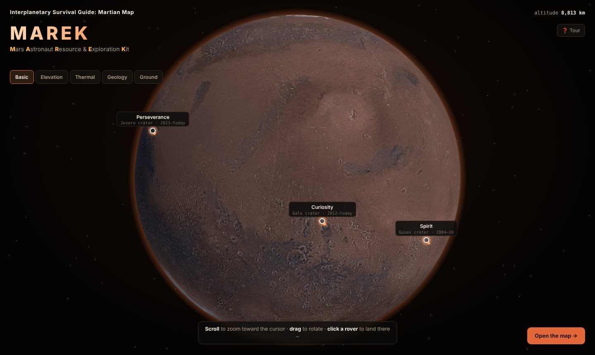
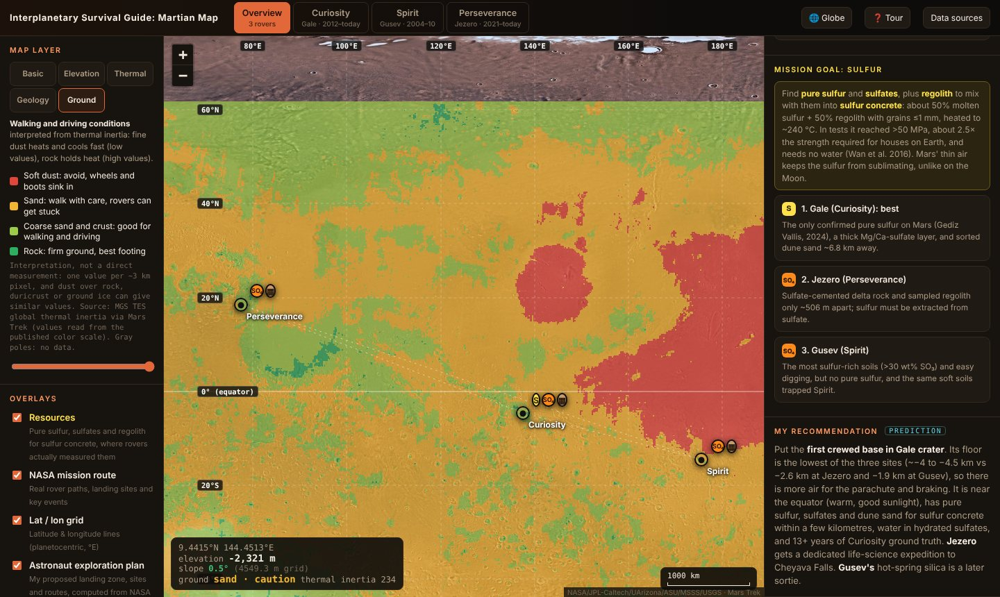
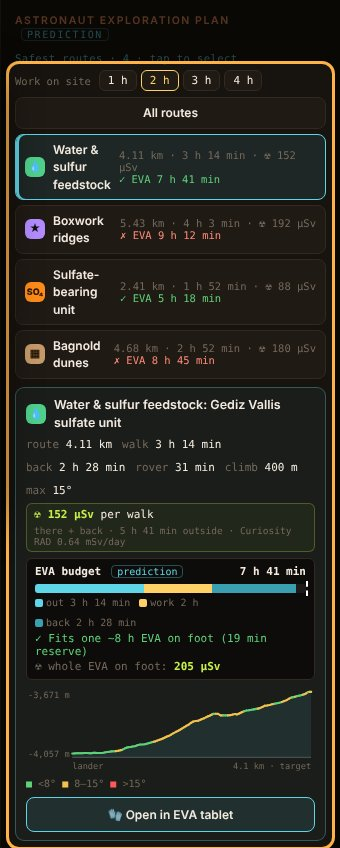
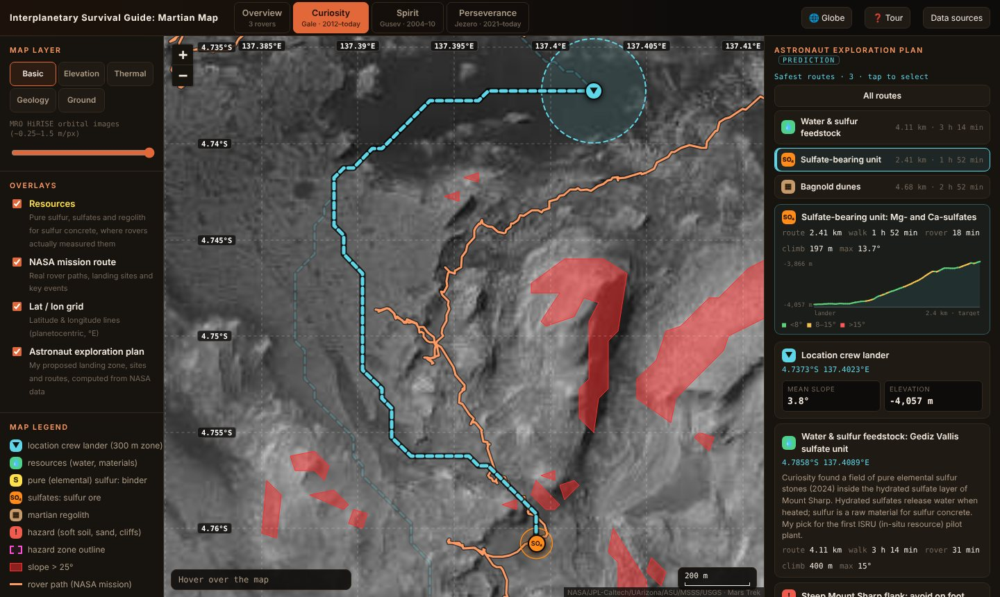

# User guide

## 0. Guided tour

On the first visit a 15-step tour starts by itself. It covers the globe controls, mission paths, layers and legends, overlays, the map-legend symbols, the readout, the mission panel, picking a single route (radiation and EVA budget), the EVA tablet and the header buttons. Use **Next → / ← Back** (or the arrow keys) to move through it, and **Skip tour** or **Esc** to close it. Reopen it anytime with **❓ Tour**, on the globe or in the map header. Add `?notour` to the URL to stop it from starting automatically.

## 1. Globe

- **Scroll** to zoom toward the point under the cursor. The altitude is shown top-right.
- **Drag** to rotate. The globe rotates slowly on its own until you touch it.
- **Basic / Elevation / Thermal / Geology / Ground** buttons change the globe texture. The chosen layer carries over to the map.
- **Click a rover label** to fly down and open that mission.
- When you zoom below ~300 km, or click **Open the map →**, the 2D map opens at the point you were looking at.
- The **🌐 Globe** button in the map header brings the globe back.

## 2. Map views

The header tabs switch between:

| Tab | Shows |
|---|---|
| **Overview** | All three sites on one map, with distances between them, the mission goal (sulfur), the site ranking and my recommendation. |
| **Curiosity** | Gale crater: Mount Sharp, the traverse to sol 5073 and the pure sulfur at Gediz Vallis. |
| **Spirit** | Gusev crater: Columbia Hills, Home Plate and Troy. |
| **Perseverance** | Jezero crater: the delta, the traverse to sol 2022 and Ingenuity's 72 flights. |

## 3. Left panel: layers

- **Map layer**
  - **Basic**: Viking color mosaic (overview) and HiRISE at the rover sites.
  - **Elevation**: height above the Mars datum, in meters. The map adds contour lines with height labels and ▲/▼ for the highest and lowest point. The legend gives the area's highest and lowest point, its relief and the contour step.
  - **Thermal**: THEMIS infrared. **Night IR** helps most: bright means rock that holds heat (firm ground) and dark means dust or sand (soft). TES thermal inertia (what the ground is likely made of) is on the **Ground** layer. The legend also shows **real measured temperatures** from Curiosity REMS (with a monthly chart), Perseverance MEDA and Spirit Mini-TES.
  - **Geology**: USGS units. Hover a point for its unit and click it for the description. The first letter of the code gives the age: **N**oachian, **H**esperian, **A**mazonian. Colored dots are **water-formed minerals** detected from orbit (clays, sulfates, chlorides, silica, carbonates); click one for details. The legend lists the minerals measured on the ground by each rover.
  - **Ground**: walking and driving conditions interpreted from MGS TES thermal inertia: **red** soft dust (< 100, avoid), **amber** sand (100–250, caution), **light green** coarse sand, duricrust, scattered rock (250–400), **green** rock and bedrock (> 400). It is an interpretation at ~3 km per pixel, not a direct measurement; hover for the value.
- **Opacity slider**: fades the chosen layer to compare it with the one below.
- **Overlays**
  - **Resources**: S, SO₄ and ▦ markers. Click one for the finding, its use and its source.
  - **NASA mission route**: real paths, landing sites, numbered events and rover-eye images (white dots).
  - **Lat / lon grid**: planetocentric latitude and longitude in °E.
  - **Astronaut exploration plan**: proposed lander (▼), sites and dashed safest routes; hazard zones (pink dashed outline: soft soil, sand, cliffs) and, on the **Basic** layer only, red areas for slopes steeper than 25° (> 47 % grade).

## 4. Right panel: the mission story

For each mission:

1. A short description and the real landing coordinates.
2. **Target resources**: a verdict for the site and every resource, with its distance from the crew lander location.
3. **NASA's planned route** (Curiosity) or the raw-image gallery link (Perseverance).
4. **NASA mission route**: a timeline. Click an entry to fly to it.
5. **Astronaut exploration plan**: the lander zone and sites. A **route picker** lists every safest route of the mission. Tap one (or click a dashed blue line on the map) to highlight it, fade the others and zoom to it. Its card gives distance, walking time, rover time, climb, steepest grade and an elevation profile coloured by slope (green <8°, yellow 8–15°, red >15°). **All routes** shows them all again.
   - **☢ Radiation**: the dose for the walk there and back. It uses the 0.64 mSv/day galactic-cosmic-ray rate that Curiosity's RAD measured in Gale (Hassler et al. 2014).
   - **EVA budget** *(prediction)*: a bar with the walk out, the work on site and the walk back, with the ~8 h EVA limit marked. ✓ means the walk fits one EVA on foot, with the reserve shown. ✗ means it does not, and the card gives the pressurised-rover option. **Work on site** above the route list sets the work time (1–4 h, default 2 h). The route list shows ✓/✗ and the EVA total for every route.
   - In Gale, the **★ boxwork science stop** (Curiosity, 2025) has its own route.
6. **🧤 EVA tablet** (header button, or **Open in EVA tablet** under a selected route): a large, glove-friendly view of one route for a crew tablet. It shows a big ✓/✗ status with the reserve and the latest time to leave the site, large tiles (distance, EVA total, walk out and back, work time with − / +, dose), the elevation profile, and 64 px **◀ ▶** buttons to switch routes. **✕ Exit** returns to the map.

## 5. Readout (bottom-left)

This shows the latitude and longitude under the cursor, the elevation in meters and the slope in degrees. Slope is green under 8°, yellow for 8–15° and red above 15°. With the Geology layer on, the geologic unit is shown too.

## 6. Data sources

The **Data sources** button opens the full list of datasets and the method. See also [DATA_SOURCES.md](DATA_SOURCES.md).
