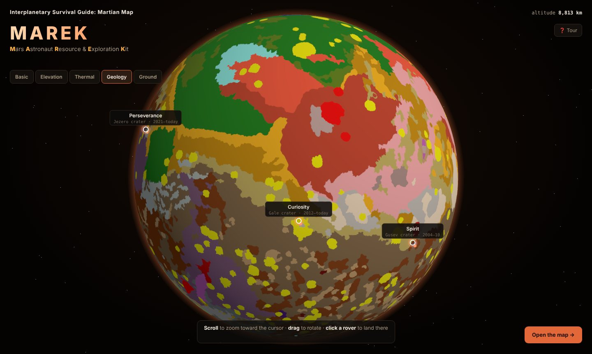
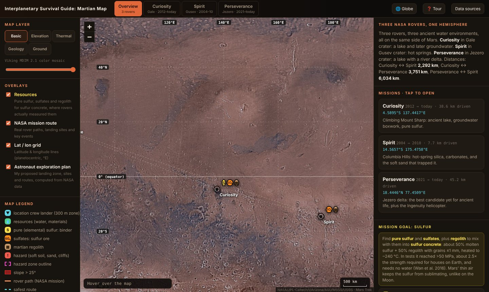
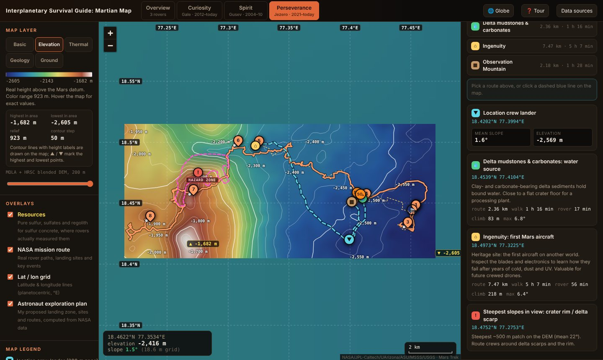
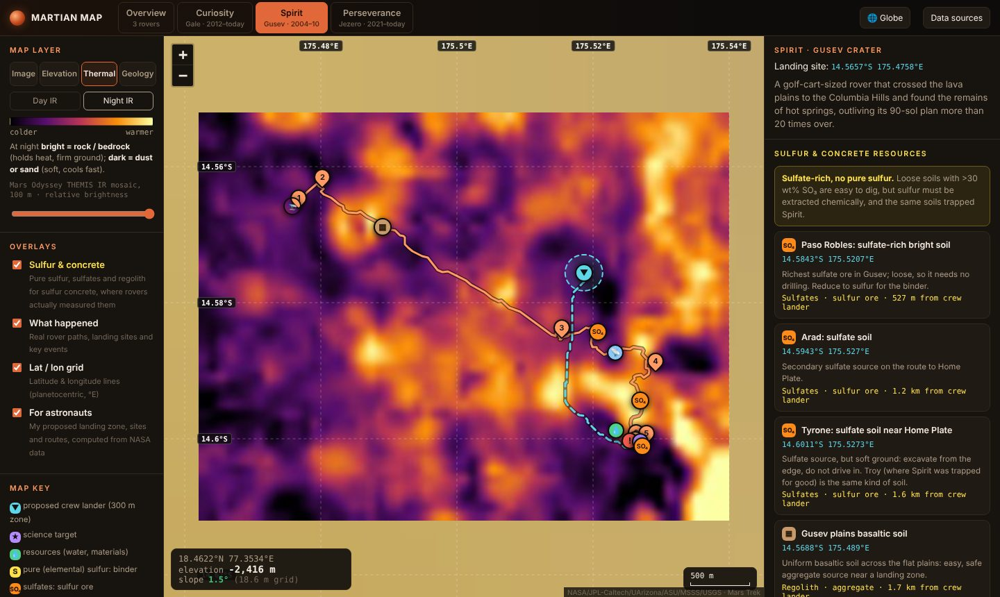

# User guide

## 0. Guided tour

On the first visit a 13-step tour starts by itself. It covers the globe controls, mission paths, layers and legends, overlays, the map-key symbols, the readout, the mission panel and the header buttons. Use **Next → / ← Back** (or the arrow keys) to move through it, and **Skip tour** or **Esc** to close it. Reopen it anytime with **❓ Tour**, on the globe or in the map header. Add `?notour` to the URL to stop it from starting automatically.

## 1. Globe

- **Scroll** to zoom toward the point under the cursor. The altitude is shown top-right.
- **Drag** to rotate. The globe rotates slowly on its own until you touch it.
- **Image / Elevation / Thermal / Geology** buttons change the globe texture. The chosen layer carries over to the map.
- **Click a rover label** to fly down and open that mission.
- When you zoom below ~300 km, or click **Open the map →**, the 2D map opens at the point you were looking at.
- The **🌐 Globe** button in the map header brings the globe back.

## 2. Map views

The header tabs switch between:

| Tab | Shows |
|---|---|
| **Overview** | All three sites on one map, with distances between them, the mission goal (sulfur), the site ranking and my recommendation. |
| **Curiosity** | Gale crater: Mount Sharp, the traverse to sol 5073 and the pure sulfur at Gediz Vallis. |
| **Spirit** | Gusev crater: Columbia Hills, Home Plate and Troy. |
| **Perseverance** | Jezero crater: the delta, the traverse to sol 2022 and Ingenuity's 72 flights. |

## 3. Left panel: layers

- **Map layer**
  - **Image**: Viking color mosaic (overview) and HiRISE at the rover sites.
  - **Elevation**: height above the Mars datum, in meters. The map adds contour lines with height labels and ▲/▼ for the highest and lowest point. The legend gives the area's highest and lowest point, its relief and the contour step.
  - **Thermal**: THEMIS infrared. **Night IR** helps most: bright means rock that holds heat (firm ground) and dark means dust or sand (soft). **Inertia** shows TES thermal inertia, and the readout gives its value and what the ground is likely made of. The legend also shows **real measured temperatures** from Curiosity REMS (with a monthly chart), Perseverance MEDA and Spirit Mini-TES.
  - **Geology**: USGS units. Hover a point for its unit and click it for the description. The first letter of the code gives the age: **N**oachian, **H**esperian, **A**mazonian. Colored dots are **water-formed minerals** detected from orbit (clays, sulfates, chlorides, silica, carbonates); click one for details. The legend lists the minerals measured on the ground by each rover.
- **Opacity slider**: fades the chosen layer to compare it with the one below.
- **Overlays**
  - **Sulfur & concrete**: S, SO₄ and ▦ markers. Click one for the finding, its use and its source.
  - **What happened**: real paths, landing sites, numbered events and rover-eye images (white dots).
  - **Lat / lon grid**: planetocentric latitude and longitude in °E.
  - **For astronauts**: proposed lander (▼), sites and dashed safe routes.

## 4. Right panel: the mission story

For each mission:

1. A short description and the real landing coordinates.
2. **Sulfur & concrete resources**: a verdict for the site and every resource, with its distance from the proposed crew lander.
3. **NASA's planned route** (Curiosity) or the raw-image gallery link (Perseverance).
4. **What happened**: a timeline. Click an entry to fly to it.
5. **For astronauts**: the lander zone and sites. Routes give distance, walking time, rover time, climb and steepest grade.

## 5. Readout (bottom-left)

This shows the latitude and longitude under the cursor, the elevation in meters and the slope in degrees. Slope is green under 8°, yellow for 8–15° and red above 15°. With the Geology layer on, the geologic unit is shown too.

## 6. Data sources

The **Data sources** button opens the full list of datasets and the method. See also [DATA_SOURCES.md](DATA_SOURCES.md).
